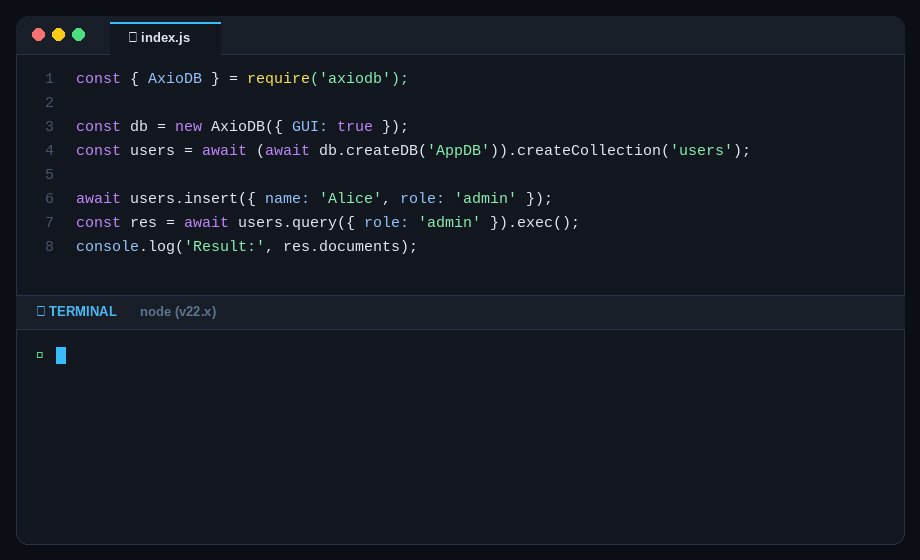

<p align="center">
  
</p>

<h1 align="center">Embedded NoSQL Database for TypeScript & Agents</h1>
<p align="center"><b>Zero-native embedded database with ACID transactions & in-memory cache — verified on Node.js & Bun.</b></p>

<p align="center">
  <a href="#quick-start"></a>
  <a href="https://axiodb.in"></a>
</p>

<p align="center">
  
</p>

[](https://github.com/nexoral/AxioDB/actions/workflows/Push.yml)
[](https://badge.fury.io/js/axiodb)
[](https://www.npmjs.com/package/axiodb)
[](https://www.npmjs.com/package/axiodb)
[](https://www.npmjs.com/package/axiodb)
[](https://www.npmjs.com/package/axiodb)
[](https://www.jsdelivr.com/package/npm/axiodb)
[](https://www.npmjs.com/package/axiodb)
[](https://www.npmjs.com/package/axiodb)
[](https://www.npmjs.com/package/axiodb)
[](https://nodejs.org)
[](https://github.com/nexoral/AxioDB/actions/workflows/Push.yml)
[](https://github.com/nexoral/AxioDB/actions/workflows/Push.yml)
[](https://axiodb.in)
[-8A2BE2)](https://axiodb.in/performance)
[](https://axiodb.in)
[](https://www.typescriptlang.org/)
[](https://opensource.org/licenses/MIT)
[](https://github.com/nexoral/AxioDB/pulls)
[](https://github.com/nexoral/AxioDB)
[](https://github.com/nexoral/AxioDB/forks)
[](https://github.com/nexoral/AxioDB/graphs/contributors)
[](https://github.com/nexoral/AxioDB/commits/main)

👉 **[Official Documentation — axiodb.in](https://axiodb.in/)**: full guides, API reference, and examples. This README is a quick start.

## Quick start

### Node.js & Bun

```bash
npm install axiodb
```

```javascript
const { AxioDB } = require('axiodb');

const db = new AxioDB();
const users = await (await db.createDB('AppDB')).createCollection('users');

await users.insert({ name: 'Alice', age: 30 });
const { data } = await users.query({ age: { $gt: 25 } }).Sort({ age: -1 }).Limit(10).exec();
console.log(data.documents);
```

### Deno (zero install via URL)

No installation required in Deno — import directly via `esm.sh`:

```typescript
import { AxioDB } from 'https://esm.sh/axiodb';

const db = new AxioDB();
const users = await (await db.createDB('AppDB')).createCollection('users');

await users.insert({ name: 'Alice', age: 30 });
const { data } = await users.query({ age: { $gt: 25 } }).Sort({ age: -1 }).Limit(10).exec();
console.log(data.documents);
```

No server to run, no `node-gyp`, no `electron-rebuild`. Requires Node.js ≥22 (also verified on Bun v1.4.0).

### 🤖 AI Agent Skill

Building with Claude Code, Cursor, Copilot, Antigravity, or Windsurf? Install the official AxioDB skill so your AI agent generates verified query syntax, accurate transaction patterns, and avoids hallucinated APIs:

```bash
npx skills add nexoral/AxioDB --skill skill
```

## Why AxioDB?

* 📦 **Zero Setup & Zero C++:** Pure JavaScript and TypeScript. No `node-gyp` errors, no build tools, and no native compilation issues on Node.js, Bun, or Electron.
* 📄 **Native JSON (No SQL Migrations):** Store raw objects directly. Perfect for AI agents, chats, and apps where data structures change often and SQL schemas are painful.
* 🛡️ **Safe from Crashes & Corruption:** Uses real ACID transactions and Write-Ahead Logging (WAL). Even if your app or server crashes mid-write, your data stays intact.
* ⚡ **Fast In-Memory Caching:** Delivers sub-millisecond (<1ms) reads with a built-in memory cache and fast disk indexes.
* 🤖 **AI-Ready:** Works out-of-the-box with AI coding assistants (Cursor, Claude Code, Copilot) via our official agent skill.

## When to Use It

**Great for:**
* **AI Agent Memory** — Save conversation history, tool calls, and agent state locally.
* **Desktop & Electron Apps** — An embedded database that never breaks on user machines during updates.
* **CLI Tools & Local Apps** — Save and query data easily without running a database server.
* **Fast Prototyping** — Build full features with advanced queries without setting up Docker or cloud DBs.

**Best fit:** 1,000 to 500,000 documents.

**When NOT to use it:**
* Millions of records, hundreds of concurrent web connections, or distributed clusters — use PostgreSQL or MongoDB instead. See [measured limits](https://axiodb.in/limitations).

## Features & Ecosystem

AxioDB is designed to be **fully functional out of the box** with zero setup, while offering dedicated companion tools for advanced workflows.

### 📦 Built Directly Into the Core Package (`npm install axiodb`)

Everything below is included in the main zero-dependency package — no extra servers, no Docker, and no native C++ compilation:

* 🚀 **Zero-Setup Embedded Database** — Runs directly inside your application with `new AxioDB()`. No background database processes to install or manage.
* 🛡️ **Crash-Proof Data Safety** — Incomplete writes roll back automatically if your app, server, or power cuts out mid-operation, ensuring your data is never corrupted.
* ⚡ **Sub-Millisecond Reads (<1ms)** — Delivers blazing-fast queries with automatic in-memory caching and disk indexing, without needing to configure a separate Redis layer.
* 🔍 **Rich Querying & Data Joins** — Filter documents with intuitive operators (`$gt`, `$in`, `$regex`), paginate, sort, and join multiple collections with aggregation pipelines (`$lookup`).
* 🤖 **Built-in AI Agent MCP Server** — Pass `{ MCP: true }` to instantly boot an official Model Context Protocol server on port 27020, giving Claude, Cursor, and autonomous AI agents 45 tools to manage database state.
* 🌐 **Built-in HTTP REST & TCP Servers** — Turn on `{ HTTP: true }` (port 27018) or `{ TCP: true }` (port 27019) whenever you need remote microservices, worker processes, or client apps to talk to the same database.

### 🛠️ Optional Companion Tools

Install these only when you need dedicated standalone apps or command-line scripting:

* 🖥️ **Desktop App (Electron GUI)** — A standalone desktop management application for Linux, macOS, and Windows to manage local and remote AxioDB instances without opening a web browser.
* ⚡ **Terminal CLI (Go Binary)** — A lightweight, standalone CLI binary with an interactive REPL shell, TLS remote connections, and database backup/export/import tools.
* 🤖 **AI Agent Skill** — Run `npx skills add nexoral/AxioDB --skill skill` to equip your AI coding assistant (Cursor, Claude Code, Windsurf, Copilot) with verified query syntax and schemas.
* 🐳 **Official Docker Container** — Deploy `theankansaha/axiodb` in Kubernetes, cloud servers, or Docker Compose with all surfaces (HTTP, TCP, MCP) ready to run.

## Performance & Testing

AxioDB is verified across **14 isolated test suites (329+ tests)** with a 100% pass rate, benchmarked at 100,000 documents on an AMD Ryzen 5 5500U / Node v26:

| Operation | Latency |
|---|---|
| Indexed query | 1–2 ms |
| `documentId` point lookup | <1 ms |
| In-memory cache hit | <1 ms |
| Range query ($gt/$gte/$lt/$lte) | 2–5 ms |
| Sorted pagination (`.Sort().Limit()`) | 1–2 ms |
| Insert single | ~31 ms |
| Rollback | ~8 ms |

Full performance charts, test suites, and methodology: [axiodb.in/performance](https://axiodb.in/performance).

## Tooling & Deployment

### Desktop GUI & CLI

AxioDB ships an interactive Go CLI and an Electron desktop app for Linux, macOS, and Windows:

**Linux / macOS:**
```bash
curl -fsSL https://raw.githubusercontent.com/nexoral/AxioDB/main/cli/Scripts/install.sh | bash
```

**Windows (PowerShell):**
```powershell
irm https://raw.githubusercontent.com/nexoral/AxioDB/main/cli/Scripts/install.ps1 | iex
```

Prebuilt binaries are also available on [GitHub Releases](https://github.com/nexoral/AxioDB/releases).

### Docker

```bash
docker run -d --name axiodb-server \
  -p 27018:27018 -p 27019:27019 \
  -v axiodb-data:/app \
  theankansaha/axiodb
```

All surfaces default to on, seeded with an `admin` account. See [Docker/README.md](Docker/README.md) for environment variables and configuration.

## Documentation

| Page | Covers |
|---|---|
| [axiodb.in](https://axiodb.in/) | Documentation home |
| [Create a database](https://axiodb.in/create-database) | Constructor options, collections, indexes |
| [API reference](https://axiodb.in/api-reference) | Full method signatures and types |
| [AxioDBCloud](https://axiodb.in/cloud) | Remote TCP access, TLS, authentication |
| [Server API](https://axiodb.in/server-api) | The 41 HTTP endpoints |
| [CLI](https://axiodb.in/cli) | Go CLI reference |
| [Docker](https://axiodb.in/docker) | Image and environment variables |
| [Security](https://axiodb.in/security) | RBAC roles, password policy, rate limits |
| [MCP server](https://axiodb.in/mcp-server) | AI agent integration |
| [Agent Skill](https://axiodb.in/.well-known/agent-skills/axiodb/SKILL.md) | AI agent progressive disclosure reference & runbooks |
| [Limitations](https://axiodb.in/limitations) | Scope and measured limits |
| [Comparison](https://axiodb.in/comparison) | Against SQLite, JSON files, lowdb, nedb, better-sqlite3 |

## Contributing, security & license

Contributions are welcome — see [CONTRIBUTING.md](CONTRIBUTING.md) and [CODE_OF_CONDUCT.md](CODE_OF_CONDUCT.md).

Security issues: report privately through [GitHub Security Advisories](https://github.com/nexoral/AxioDB/security/advisories/new). Policy details in [SECURITY.md](SECURITY.md).

Released under the [MIT License](LICENSE). Author: Ankan Saha.

Support the project with a ⭐ on [GitHub](https://github.com/nexoral/AxioDB) or through [GitHub Sponsors](https://github.com/sponsors/AnkanSaha).
